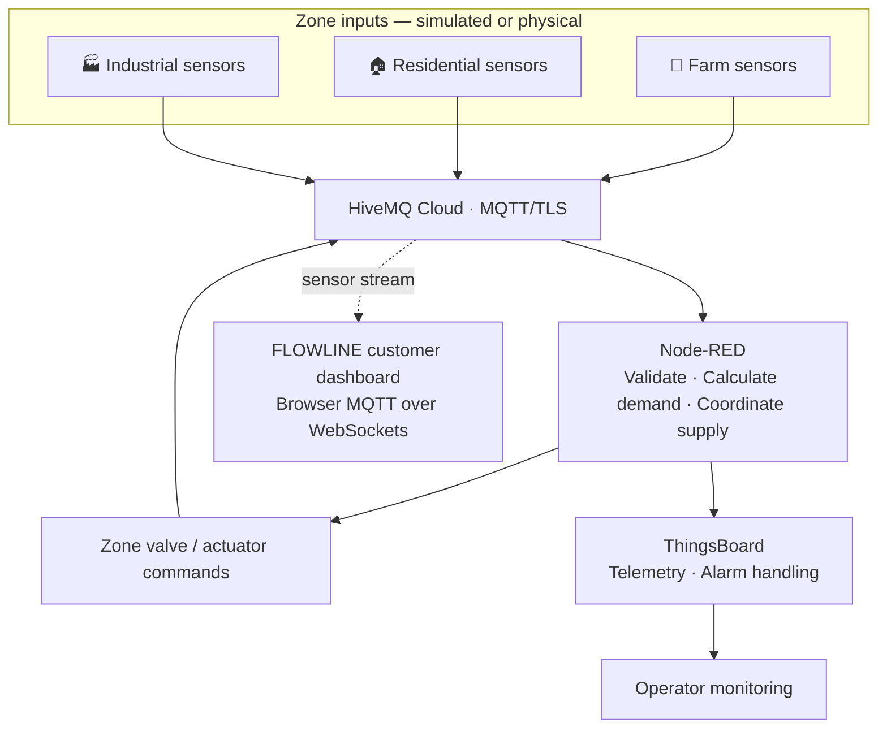

<div align="center">

# 💧 FLOWLINE
### Smart Water Distribution & Monitoring System

**See the water. Understand the demand. Respond to the problem.**

A connected water-monitoring and distribution prototype for three zones — **Farm, Residential, and Industrial** — combining ESP32/Wokwi nodes, MQTT messaging, Node-RED decision logic, and ThingsBoard telemetry/alerts.

<br/>


</div>

---

## ✨ At a glance

| 🌾 Farm | 🏠 Residential | 🏭 Industrial |
|:---:|:---:|:---:|
| Level, temperature, flow, rainfall and optional soil moisture | Level, temperature and flow | Level, temperature and flow |
| Irrigation-aware demand | Household supply demand | Temperature-aware industrial demand |

**The idea:** collect readings from separate zones, evaluate demand centrally, coordinate a shared water supply, and send zone-specific valve commands while exposing telemetry and alerts.

## 🖥️ Simulations

| Zone | Open simulation |
|---|---|
| 🌾 Farm | [Launch Farm on Wokwi](https://wokwi.com/projects/477882130212484097) |
| 🏠 Residential | [Launch Residential on Wokwi](https://wokwi.com/projects/477882137550422017) |
| 🏭 Industrial | [Launch Industrial on Wokwi](https://wokwi.com/projects/477882142623433729) |

> **Implementation note:** the Wokwi sketches represent separate zone nodes. The intended physical prototype uses one shared ESP32 and pump/motor-driver hardware; the simulated servos are not a claim about the physical actuator design.

---

## 🧭 System architecture



### How data moves

1. **Sense** — each zone publishes its latest readings.
2. **Transport** — MQTT carries messages between zone nodes and the backend.
3. **Validate** — Node-RED checks the zone and payload and applies configured range/decision rules.
4. **Decide** — the flow calculates demand, considers the shared supply, and determines valve commands.
5. **Act** — zone-specific commands are published back through MQTT.
6. **Observe** — telemetry and supported alarm events are forwarded to ThingsBoard; the customer dashboard consumes the sensor topics.

---

## 🧠 Decision logic highlights

The current Node-RED flow includes:

- **Zone-aware demand calculation** with different weights for Farm, Residential, and Industrial.
- **Shared-supply coordination** with a configured total supply of `80` flow units and zone minimum-share/priority settings.
- **Valve safety clamping** to the configured `0°–90°` range; closed mode forces the valve command to `0°`.
- **Sensor validation and fault handling**, including consecutive invalid readings and stuck/flatline checks.
- **Water-level and flow alarms**, including clear thresholds to reduce alarm flapping.
- **Closed-zone leak suspicion** when flow remains after a closing grace period.
- **Farm-specific context**, including rainfall and optional soil-moisture adjustment.
- **Saved operating modes** restored from retained MQTT messages at startup.
- **ESP offline/recovery detection** in the Node-RED flow.

The exact values live in the **Decision Logic** function inside `Smart_Water_Final_Version.json`; change them there rather than maintaining a second, conflicting copy in documentation.

<details>
<summary><strong>Selected configured thresholds</strong></summary>

| Rule | Current configured value |
|---|---:|
| Critical low water level | `10%`; clears at `15%` |
| Critical high water level | `90%`; clears at `85%` |
| Near-zero flow | `2`; clears at `4` |
| High flow | `45`; clears at `40` |
| Leak suspicion while closed | Flow above `5`; clears at `3` |
| Leak grace period after closing | `30 seconds` |
| High-temperature alarm | Above configured `40 °C` threshold |
| ESP offline watchdog | `60 seconds` |
| Sensor-fault threshold | `3` consecutive bad readings |

These are configuration values from the supplied Node-RED flow, not a claim that every scenario has been field-validated. Units and behavior should be checked against the sensor setup before a real deployment.

</details>

---

## 📡 MQTT topic map

| Direction | Topic | Purpose |
|---|---|---|
| Zone → backend | `smartwater/farm/sensors` | Farm readings |
| Zone → backend | `smartwater/residential/sensors` | Residential readings |
| Zone → backend | `smartwater/industrial/sensors` | Industrial readings |
| Backend → zone | `smartwater/farm/valve` | Farm valve command |
| Backend → zone | `smartwater/residential/valve` | Residential valve command |
| Backend → zone | `smartwater/industrial/valve` | Industrial valve command |
| Backend ↔ mode state | `smartwater/+/mode` | Saved/restored zone mode |
| ThingsBoard → Node-RED | `v1/gateway/rpc` | Gateway RPC commands |
| Node-RED → ThingsBoard | `v1/gateway/telemetry` | Gateway telemetry |

**Common telemetry fields:** `temp`, `level`, `flow`, `rain`, optional `soil`, and system/control fields such as `mode`, `isClosed`, `valveAngle`, `demand`, `targetFlow`, `levelBand`, `sharePct`, `sensorFault`, `alarmCount`, and `activeAlarms`. Fields depend on the zone and message type.

### Example test message

Publish to `smartwater/farm/sensors`:

```json
{
  "temp": 26,
  "level": 72,
  "flow": 18,
  "rain": 0,
  "soil": 48
}
```

This is **synthetic test data**, not a real sensor reading. Keep JSON numeric fields numeric, and use the exact topic for the zone being tested.

---

## 🚨 Monitoring and alarms

The Node-RED flow evaluates alarm conditions and formats supported telemetry/alarm information for ThingsBoard. The customer-facing HTML dashboard is a separate browser client that subscribes to MQTT sensor topics.

- **Sensor readings** can update directly from the subscribed zone topics.
- **Inferred dashboard warnings** are not the same thing as confirmed ThingsBoard alarms.
- **True alarm creation and clearing** can only be shown reliably when the dashboard is connected to an actual alarm event source that exposes both transitions. Do not assume a sensor message alone represents an alarm-created or alarm-cleared event.

For a live demonstration, verify the complete path: publish input → observe Node-RED decision → confirm ThingsBoard event/telemetry → confirm the customer view.

---

## 🚀 Getting started

### 1. Requirements

- Node-RED with the project flow imported
- HiveMQ Cloud cluster and an MQTT client account
- ThingsBoard gateway/device configuration for the configured telemetry and RPC topics
- Wokwi for the three simulations, or compatible ESP32 hardware
- A browser for the customer dashboard

### 2. Configure credentials safely

1. Open each Wokwi sketch and replace the MQTT credential placeholders with credentials created for your own HiveMQ cluster.
2. Configure the same broker connection in Node-RED.
3. For a browser dashboard, use **MQTT over WebSockets** with the WebSocket endpoint/path enabled for your cluster. The current flow uses MQTT/TLS on port `8883` for its regular MQTT client; browser WebSocket settings are separate.
4. Enter browser credentials locally in the dashboard settings if required.

**Never commit real usernames, passwords, access tokens, or private endpoints to a public repository.** Use placeholders in examples and rotate any credential that has been exposed.

### 3. Import and run Node-RED

1. Import `Smart_Water_Final_Version.json`.
2. Review broker credentials and the ThingsBoard gateway configuration.
3. Deploy the flow.
4. Start one or more Wokwi zone simulations and confirm messages arrive on the expected sensor topics.
5. Confirm telemetry and command paths before testing actuation.

### 4. Open the dashboard

Open the supplied `flowline_customer_dashboard.html` locally, configure the browser MQTT-over-WebSockets connection, and connect. Demo/preview values should be clearly distinguished from live readings. Check the browser console and connection indicator if live values do not change.

> The HTML dashboard is a standalone prototype. Browser MQTT connectivity and real alarm-event synchronization must be verified in the target environment before presenting it as production-ready.

---

## 🧪 Test checklist

- [ ] Normal readings arrive for each zone.
- [ ] A new MQTT message changes the correct zone without a page reload.
- [ ] Invalid or missing fields do not silently become valid-looking readings.
- [ ] Low/high water-level boundaries trigger and clear as configured.
- [ ] Low/high flow conditions trigger and clear as configured.
- [ ] Flow while a zone is closed is checked after the configured grace period.
- [ ] Sensor-fault and offline/recovery paths are verified.
- [ ] Valve commands remain inside the safety clamp.
- [ ] ThingsBoard alarm creation **and clearing** are confirmed independently.
- [ ] Stale/disconnected data is visibly distinguished from live data.

Record test inputs, timestamps, expected results, observed results, and pass/fail evidence. Clearly label synthetic inputs.

---

## 📁 Suggested repository layout

```text
flowline-smart-water/
├── README.md
├── dashboard/
│   └── flowline_customer_dashboard.html
├── node-red/
│   └── Smart_Water_Final_Version.json
├── thingsboard/
│   └── smart_water_complete_alert_rule_chain.json
├── wokwi/
│   ├── farm/
│   │   ├── sketch.ino
│   │   ├── diagram.json
│   │   └── libraries.txt
│   ├── residential/
│   │   ├── sketch.ino
│   │   ├── diagram.json
│   │   └── libraries.txt
│   └── industrial/
│       ├── sketch.ino
│       ├── diagram.json
│       └── libraries.txt
├── docs/
│   ├── architecture/
│   ├── circuit-and-bom/
│   └── testing-evidence/
└── .gitignore
```

Keep exported files in their relevant folders, rename duplicate filenames clearly, and do not commit secrets or unnecessary generated files.

## 🛡️ Safety and scope

This is a graduation-project prototype, not a certified water-management or safety controller. Validate sensor ranges, units, actuator behavior, network-loss behavior, and alarm delivery before connecting real pumps or using it for operational decisions. Use suitable low-voltage hardware and appropriate supervision.

## 📌 Project files

- [Farm simulation](https://wokwi.com/projects/477882130212484097)
- [Residential simulation](https://wokwi.com/projects/477882137550422017)
- [Industrial simulation](https://wokwi.com/projects/477882142623433729)

---

<div align="center">

**FLOWLINE — from sensor readings to coordinated water decisions.**

*Built as an IoT graduation project.*

</div>
