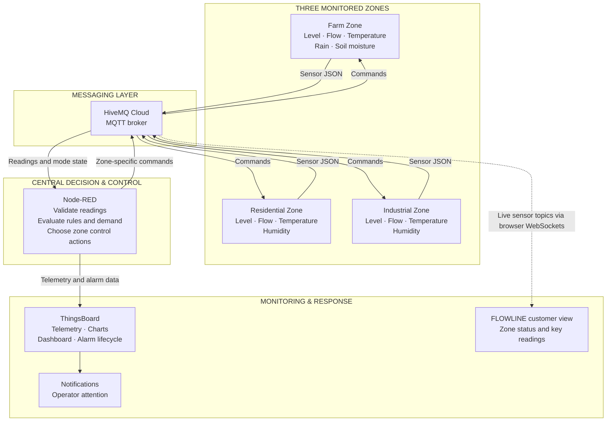
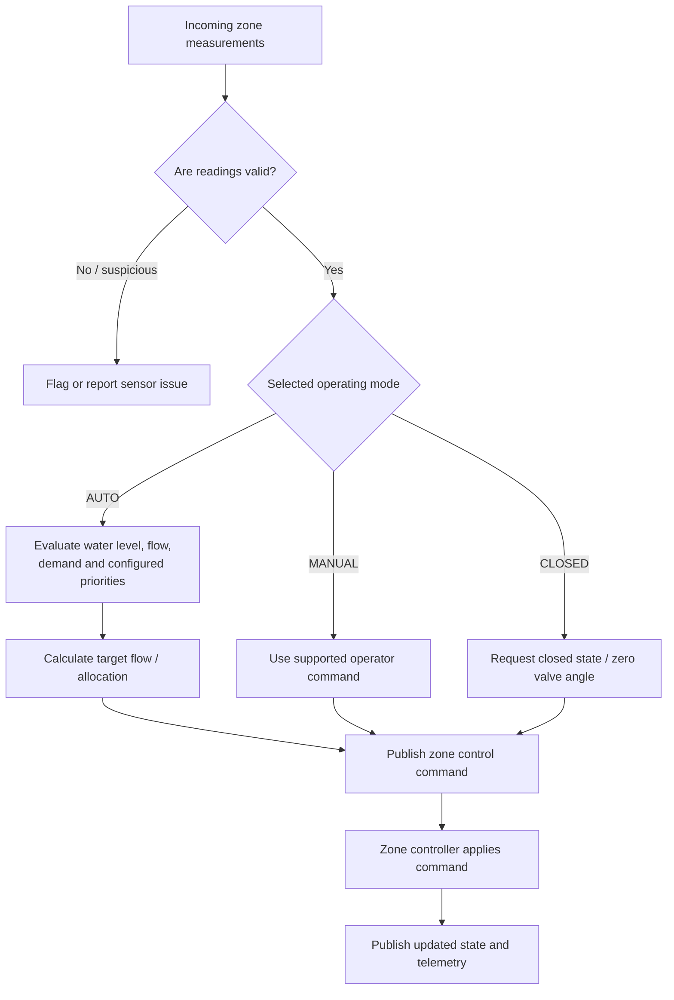
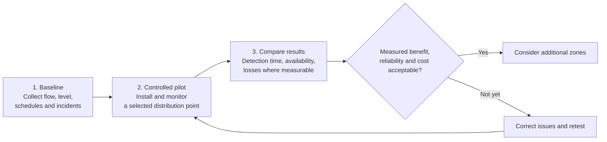

# 💧 FLOWLINE
### Smart Water Distribution & Monitoring System

**Smart Control · Fair Distribution · Sustainable Water**

An IoT graduation project connecting **Farm, Residential, and Industrial** water zones through sensor monitoring, centralized decision logic, remote control, and alarm visibility.

[🌾 Farm Simulation](https://wokwi.com/projects/477882130212484097) · [🏠 Residential Simulation](https://wokwi.com/projects/477882137550422017) · [🏭 Industrial Simulation](https://wokwi.com/projects/477882142623433729)

---

## 🌊 The idea behind FLOWLINE

Water distribution serves different users with different operating needs. Agricultural irrigation depends on water availability and environmental conditions; residential areas depend on a visible and reliable supply; and industrial facilities need their own monitored distribution branch.

FLOWLINE demonstrates an integrated way to **measure conditions, communicate readings, evaluate configured rules, coordinate water delivery, and notify operators when something needs attention**.

The project combines an ESP32-based prototype, MQTT messaging through HiveMQ Cloud, Node-RED for centralized decision-making, ThingsBoard for telemetry and alarm management, and three independent Wokwi simulations.

> 💡 **Project scope:** This is a prototype demonstrating connected monitoring and control. Water savings, leak-detection accuracy, and large-scale operational improvements remain outcomes to measure in a field pilot—not claims assumed from the design alone.

---

## 🗺️ System at a glance

### What each part does

| Component | Responsibility |
|---|---|
| **ESP32** | Reads sensors, publishes JSON measurements, receives commands, and operates connected hardware. |
| **HiveMQ Cloud** | Carries MQTT messages between zone devices and the central processing layer. |
| **Node-RED** | Validates measurements, evaluates configured distribution rules, manages modes, and sends zone-specific control commands. |
| **ThingsBoard** | Displays telemetry and historical trends, exposes supported controls, and manages alarm creation and clearing through its Rule Chain. |
| **FLOWLINE customer dashboard** | Presents zone status and key readings in a visual, approachable interface. Its live connection depends on browser-compatible MQTT-over-WebSockets settings. |
| **Telegram notifications** | Provides an additional notification path for configured alarm events. |

---

## 🔁 How data moves through the system

1. **Measure:** Each zone contributes measurements for water level, flow, and environmental conditions. The Farm zone also includes soil-moisture and rainfall-related inputs where available. The simulation uses adjustable inputs to represent changing conditions without requiring every physical sensor.
2. **Send:** The zone controller publishes a JSON message to its zone-specific MQTT sensor topic. Separating topics makes it possible to identify the source zone and process each branch independently.
3. **Evaluate:** Node-RED validates incoming data and applies the configured logic. The control flow considers zone operating mode, water level, flow, demand, and configured allocation settings before producing a control decision.
4. **Act:** Node-RED publishes a command to the relevant zone's control topic. In Wokwi, the simulated ESP32 adjusts a servo that represents a valve position. In the physical prototype, DC pumps and motor-driver circuits move water to the zone reservoirs.
5. **Observe and respond:** Telemetry is sent to ThingsBoard for monitoring and historical charts. The ThingsBoard Rule Chain evaluates its configured alarm conditions, creates alarms when appropriate, and clears them when recovery conditions are met. Telegram notifications provide another way to surface selected events.

---

## 🧩 Three zones, three operating contexts

### 🌾 Farm Zone

Agricultural monitoring combines water availability with environmental context. The design includes water level, flow, temperature and humidity, plus soil-moisture and rainfall-related inputs where available. These inputs can inform irrigation demand.

**Simulation:** [Open Farm on Wokwi](https://wokwi.com/projects/477882130212484097)

### 🏠 Residential Zone

The residential branch tracks water level, flow, temperature and humidity. Its separate readings allow the central logic to monitor supply conditions independently from agricultural and industrial needs.

**Simulation:** [Open Residential on Wokwi](https://wokwi.com/projects/477882137550422017)

### 🏭 Industrial Zone

The industrial branch contributes its own water-level, flow and environmental readings. Separate monitoring makes it easier to review its operating conditions and include it in shared distribution decisions.

**Simulation:** [Open Industrial on Wokwi](https://wokwi.com/projects/477882142623433729)

---

## 🧰 Physical prototype vs. Wokwi simulation

These are two related implementations of the same monitoring-and-control concept, but their hardware arrangements are different.

| Feature | Physical prototype | Wokwi simulations |
|---|---|---|
| **Controller layout** | One shared ESP32 for the three zones | Three independent ESP32 nodes, one per zone |
| **Water movement / actuation** | DC pumps controlled through motor-driver circuits | Servo motors represent adjustable valve positions |
| **Water level** | Ultrasonic sensor above each reservoir | Potentiometer used as an adjustable level input |
| **Farm environmental inputs** | Soil-moisture sensor and DHT22; ultrasonic level sensor | DHT22 plus adjustable soil, level, rain and flow inputs |
| **Residential & Industrial inputs** | DHT11 and ultrasonic level sensor in each zone | DHT sensor model and adjustable level/flow inputs |
| **Purpose** | Demonstrate physical water transfer and sensor monitoring | Test zone messages, modes, control commands and simulated valve response |

> 📌 **Important:** A simulated servo indicates a requested valve position; it is not a pump and does not prove real hydraulic flow. The physical prototype uses DC pumps to transfer water between the main supply and the three zone reservoirs. The documentation also describes an LCD as a planned addition to show local status.

---

## 📡 MQTT communication map

The zone name is `farm`, `residential`, or `industrial`. Sensor readings, control commands, and operating mode are separated into distinct topics.

| Topic | Message purpose |
|---|---|
| `smartwater/farm/sensors` | Farm sensor readings |
| `smartwater/residential/sensors` | Residential sensor readings |
| `smartwater/industrial/sensors` | Industrial sensor readings |
| `smartwater/farm/valve` | Farm control commands |
| `smartwater/residential/valve` | Residential control commands |
| `smartwater/industrial/valve` | Industrial control commands |
| `smartwater/+/mode` | Zone operating-mode messages |
| `v1/gateway/telemetry` | Node-RED to ThingsBoard gateway telemetry |
| `v1/gateway/rpc` | ThingsBoard remote-procedure-call path |

### Data carried by the system

Depending on the zone and message, telemetry may include:

- **Measurements:** `temp`, `level`, `flow`, `rain`, `soil`, `humidity`
- **Operating state:** `mode`, `isClosed`, `valveAngle`
- **Distribution logic:** `demand`, `targetFlow`, `levelBand`, `sharePct`
- **Diagnostics and alarms:** `sensorFault`, `alarmCount`, `activeAlarms`

The exact fields depend on the message source and current flow configuration; not every field is present in every zone payload.

---

## 🧠 Central control: modes and distribution

The control design separates **automatic decisions** from **operator-directed actions**.

- **AUTO:** Node-RED evaluates measurements and calculated demand against configured rules to determine the requested control action.
- **MANUAL:** The operator can issue supported control commands through the dashboard.
- **CLOSED:** The zone is commanded to a closed state; the documented valve representation uses a zero-degree command.
- **Allocation:** The control design calculates demand and target flow and considers configured minimum shares and zone priorities when coordinating the shared supply.
- **Stability:** The documented logic includes timing constraints and a deadband to avoid unnecessary repeated adjustments.

The precise allocation values and thresholds are configuration-dependent. They should be read from the active Node-RED flow rather than assumed from a general project description.

---

## 🚨 Monitoring and alarm lifecycle

Node-RED and ThingsBoard have related but separate responsibilities:

- **Node-RED** evaluates operating conditions, coordinates control, and prepares telemetry and alarm information.
- **ThingsBoard Rule Chain** processes incoming messages and has dedicated alarm creation and clearing paths for configured conditions.
- **Telegram** is used for selected operator notifications.

The documented alarm categories include:

| Condition | What it can indicate |
|---|---|
| **Low / high water level** | Water availability outside the configured range |
| **Low / high flow** | Abnormal flow that may indicate a blockage, valve issue, or unusual operating condition |
| **High temperature** | Temperature above the configured threshold |
| **Suspected leak** | Flow continuing while a zone is reported closed, after the configured grace period |
| **Sensor fault** | Repeated invalid sensor readings |
| **ESP offline** | No telemetry received within the configured inactivity period |
| **Recovery** | A monitored condition returns to its configured normal range |

> 🔔 **Alarm clearing matters:** An alarm should reflect the current lifecycle of a condition—not remain visible indefinitely after recovery. The Rule Chain includes Create Alarm and Clear Alarm paths. Node-RED and ThingsBoard evaluate conditions separately, so their thresholds and recovery rules need to be kept consistent and verified during runtime tests. The documentation specifies an offline interval of more than 60 seconds and describes leak checking after more than 30 seconds while closed; exact behavior depends on the active configuration.

---

## 📊 Dashboard and operator experience

The ThingsBoard dashboard brings the three zone panels into one monitoring interface. The documented views include:

- Current water level, flow rate, target flow and temperature
- Water demand, operating mode, valve status and valve angle
- Rain status where applicable
- Historical water-level and flow-rate charts for each zone
- A centralized network visualization of the Farm, Residential and Industrial branches
- AUTO, MANUAL and CLOSED controls, including a close-valve action and manual valve-angle slider
- Alarm visibility through ThingsBoard

The project also includes a separate customer-facing FLOWLINE dashboard concept intended to make key conditions easier to understand visually. It is distinct from the ThingsBoard dashboard and should only be described as live when its browser MQTT-over-WebSockets connection is successfully receiving current broker messages.

**Known dashboard limitation from the documentation:** Some manual valve-opening interactions required a page refresh before the updated state was visible. This is an identified improvement area, not a feature that should be presented as fully resolved.

---

## 🧪 Verification evidence

The project documentation records tests using published MQTT readings and observations in Node-RED, ThingsBoard and Telegram. The following table summarizes what the documentation reports—not a claim that every test has been rerun against every current file revision.

| Test scenario | Documented outcome |
|---|---|
| Farm low water level (`level: 5`) | **Passed.** `levelBand: low`, `LEVEL_LOW`, and an alarm count of 1 were reported in ThingsBoard telemetry. |
| Farm high water level (`level: 95`) | **Passed.** A critical, unacknowledged High Water Level alarm was displayed. |
| Low flow (`flow: 1`) | **Passed.** A Low Flow alarm was displayed; the event was described as a possible blockage or valve failure. |
| High temperature (`temp: 30`) | **Passed in the documented test configuration.** The test used a threshold above 25°C. This differs from a later documented test using a 40°C threshold, so the active configuration must be checked before reusing the result. |
| Invalid sensor reading | **Inconclusive in the original test.** The report says the expected Sensor Fault alarm was not observed in that specific run. Later tests documented a sensor-fault notification after sustained abnormal readings. |
| Flow while closed | **Passed.** A `LEAK` / “Leak Suspected” notification was reported for flow continuing while the zone was closed. |
| ESP offline and recovery | The report records offline detection and recovery. Validate this behavior against the active Rule Chain and current deployment before treating it as guaranteed. |
| Critical low-level alarm and recovery | **Reported successful.** Telegram notifications were recorded at 0% and recovery messages at normal-range readings for all three zones. |
| Residential zero-flow anomaly | A flow alert followed by a sensor-fault notification was documented; the exact cause of the invalid temperature reading remained unresolved. |
| High temperature across all zones | **Reported successful** for readings above the later configured 40°C threshold, with Telegram alerts for Farm, Residential and Industrial. |

The documentation therefore supports several demonstrated monitoring and notification behaviors, while also recording unresolved synchronization and dashboard-control issues. The Node-RED control flow and ThingsBoard Rule Chain are separate systems; matching alarm names alone does not guarantee matching thresholds, timing, or clear behavior.

---

## 💼 Business value and intended users

FLOWLINE is designed as a prototype for organizations that need clearer visibility over distributed water supply. The documentation identifies the Ministry of Water Resources and Irrigation and other governmental or national water-management organizations as potential customers.

| Potential user | Possible value |
|---|---|
| **Irrigation and agricultural operators** | Review water availability with soil and environmental context |
| **Residential supply operators** | See zone status and identify abnormal level or flow behavior |
| **Industrial facility teams** | Monitor a dedicated supply branch and its operating conditions |
| **Water-management organizations** | Bring distributed measurements and alarm information into a centralized view |
| **System integrators and maintainers** | Configure, support and expand a modular monitoring-and-control deployment |

Potential service models include hardware installation, system configuration, monitoring-platform integration, maintenance and technical support.

### Expected value (to be validated)

- **Visibility:** A unified view of readings and operating states across multiple zones.
- **Earlier investigation:** Alerts for configured abnormal conditions can help operators decide when to inspect a zone.
- **Coordinated operation:** Central decision logic can consider demand and configured priorities.
- **Operational flexibility:** Automatic control can coexist with supported manual intervention.
- **Expandability:** The zone-based MQTT structure can be extended to additional monitoring points.

The project aligns with broader Egyptian priorities around water security, resource utilization and digital transformation, including the direction of Egypt's Water Resources Strategy 2050. This is an alignment of purpose, not a claim of official endorsement. Quantified water savings, cost reductions and field reliability require a measured pilot.

---

## 🛣️ From prototype to field pilot

The documentation proposes a cautious, evidence-based scale-up path:

A proposed first pilot is one agricultural irrigation distribution point or another small controlled zone selected with an authorized operating partner. The documentation suggests collecting baseline data for approximately four weeks where feasible, then comparing operation over a comparable period. Expansion should depend on reliable operation, measurable benefits, acceptable cost, safety, and compatibility with the existing infrastructure.

---

## 🔭 Limitations and future work

The project documentation identifies several next steps that would move FLOWLINE toward a more deployable system:

1. **Alarm lifecycle consistency** — align Node-RED and ThingsBoard thresholds, timing, recovery rules, and clearing behavior.
2. **More reliable live status** — improve stale-data handling, connection visibility, and clear recovery states.
3. **Dashboard control responsiveness** — remove the need for page refreshes after manual control actions.
4. **Cybersecurity** — strengthen role-based access, credential management, MQTT authorization, secure remote operation, and command logging.
5. **Better leak diagnosis** — compare flow, water-level change, expected flow and commanded valve state to help distinguish leaks, blockages and equipment faults.
6. **Demand forecasting** — investigate models such as XGBoost or time-series forecasting using historical demand and agricultural context.
7. **Predictive control** — evaluate Model Predictive Control (MPC) to plan distribution actions over a future horizon while respecting supply and zone requirements.
8. **Field validation** — calibrate sensors and measure availability, detection time, water loss where measurable, response time, safety and cost before scaling.

These are future development directions, not capabilities claimed as already completed.

---

## 🔗 Simulation links

| Zone | Wokwi simulation |
|---|---|
| 🌾 Farm | [Open Farm ESP32 simulation](https://wokwi.com/projects/477882130212484097) |
| 🏠 Residential | [Open Residential ESP32 simulation](https://wokwi.com/projects/477882137550422017) |
| 🏭 Industrial | [Open Industrial ESP32 simulation](https://wokwi.com/projects/477882142623433729) |

---

## ✅ Conclusion

FLOWLINE brings sensor-based monitoring, MQTT communication, centralized decision-making, controllable distribution branches, dashboard visualization and alarm handling into one water-management prototype. Its three-zone model shows how agricultural, residential and industrial conditions can be observed through a common architecture while keeping each zone's data and control path distinct.

The project establishes a foundation for further development. The next step is not to assume large-scale benefits, but to improve alarm consistency and operator experience, strengthen security, and validate performance through repeatable tests and a controlled field pilot.

**FLOWLINE**  
*Connected water data. Coordinated decisions. Clearer visibility.*

