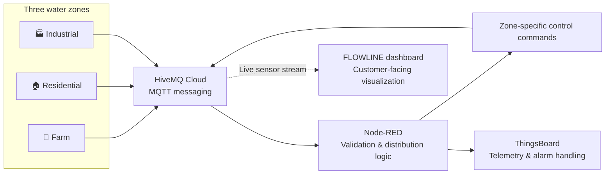

# 💧 FLOWLINE
### Smart Water Distribution & Monitoring System

**A smarter way to monitor water availability, understand demand, and coordinate distribution.**

A multi-zone IoT prototype connecting water-level and environmental readings to centralized decision logic, zone-level control, and operational visibility.

 

---

## The idea

Water distribution is not only about measuring a tank. Different areas need water for different reasons, at different times, and with different priorities. **FLOWLINE** brings those zones into one connected view, using sensor data and centralized logic to support more informed distribution decisions.

The prototype models three zones:

| 🌾 Farm | 🏠 Residential | 🏭 Industrial |
|---|---|---|
| Water availability with environmental context | Water availability and household demand | Water availability and industrial demand |
| Level, temperature, flow, rainfall and optional soil moisture | Level, temperature and flow | Level, temperature and flow |

The goal is to move from isolated readings to a system that can **observe, compare, prioritize, alert, and coordinate**.

## System at a glance

### From sensing to action

1. **Observe** — zone nodes publish sensor readings.
2. **Connect** — MQTT carries readings and control messages.
3. **Interpret** — Node-RED validates inputs and evaluates the configured distribution rules.
4. **Coordinate** — demand and zone settings inform the control decision.
5. **Respond** — commands are published for the relevant zone.
6. **Monitor** — ThingsBoard provides telemetry and alarm handling, while the customer dashboard presents zone status in a more approachable visual form.

---

## Designed around three different needs

<strong>🌾 Farm — water with environmental context</strong>

The Farm zone can combine water level, flow and temperature with rainfall and optional soil-moisture context. These inputs help represent irrigation demand more meaningfully than a tank-level value alone.

[Open Farm simulation on Wokwi →](https://wokwi.com/projects/477882130212484097)

<strong>🏠 Residential — supply visibility</strong>

The Residential zone represents household water availability. Level and flow readings provide visibility into supply conditions and help the central logic compare this zone's demand with the other zones.

[Open Residential simulation on Wokwi →](https://wokwi.com/projects/477882137550422017)

<strong>🏭 Industrial — demand and operating conditions</strong>

The Industrial zone contributes its own level, temperature and flow readings to the shared monitoring and distribution model. Keeping its data separate makes zone-level status and decisions easier to interpret.

[Open Industrial simulation on Wokwi →](https://wokwi.com/projects/477882142623433729)

> **Prototype boundary:** the Wokwi projects represent separate simulated zone nodes. The intended physical prototype uses one shared ESP32 and pump/motor-driver hardware; simulated servo valves should not be interpreted as the physical actuator design.

---

## Distribution intelligence

The Node-RED flow is the central decision layer. Its configured logic covers:

- **Demand estimation** across Farm, Residential and Industrial zones.
- **Shared-supply coordination** using a configured total supply and zone priority/minimum-share settings.
- **Zone control** through separate valve-command topics and operating modes.
- **Input validation** and sensor-fault handling for invalid or suspicious readings.
- **Water-level and flow conditions** with configured trigger/clear thresholds to reduce repeated alarm changes.
- **Closed-zone flow monitoring** to flag possible leakage when flow persists after a closing grace period.
- **Farm context** using rainfall and optional soil-moisture data.
- **Connection monitoring** for stale or offline zone devices.

The source of truth for the exact rules is the current Node-RED export, `Smart_Water_Final_Version.json`. This README describes the system's behavior at a high level rather than duplicating every configurable threshold.

## Communication map

MQTT topics keep the three zones logically separate while allowing Node-RED to coordinate them.

| Topic | Direction | Role |
|---|---|---|
| `smartwater/farm/sensors` | Farm → backend | Farm sensor readings |
| `smartwater/residential/sensors` | Residential → backend | Residential sensor readings |
| `smartwater/industrial/sensors` | Industrial → backend | Industrial sensor readings |
| `smartwater/farm/valve` | Backend → Farm | Farm control command |
| `smartwater/residential/valve` | Backend → Residential | Residential control command |
| `smartwater/industrial/valve` | Backend → Industrial | Industrial control command |
| `smartwater/+/mode` | Zone/backend | Zone operating mode state |
| `v1/gateway/telemetry` | Node-RED → ThingsBoard | Gateway telemetry |
| `v1/gateway/rpc` | ThingsBoard → Node-RED | Gateway RPC commands |

Depending on the zone and message type, payloads can include `temp`, `level`, `flow`, `rain`, `soil`, `humidity`, `mode`, `isClosed`, `valveAngle`, `demand`, `targetFlow`, `levelBand`, `sharePct`, `sensorFault`, `alarmCount`, and `activeAlarms`.

---

## Monitoring that serves people, not just devices

FLOWLINE has two complementary monitoring views:

- **Operational telemetry and alarms** in ThingsBoard for system-level monitoring.
- **A customer-facing dashboard** designed to make water level, flow, zone status, and attention-needed conditions easier to understand without exposing the underlying technical complexity.

The dashboard subscribes to the zone sensor topics through browser MQTT over WebSockets. Confirmed alarm events and alarm-cleared events require a real alarm-event source; a warning inferred from sensor values is not the same as a confirmed ThingsBoard alarm. This distinction keeps the interface honest and avoids presenting an inferred condition as an authoritative alarm record.

---

## Why it matters

### Practical value

- **Shared visibility:** compare three different zones from one system view.
- **More informed allocation:** consider demand and configured priorities rather than treating every zone identically.
- **Earlier awareness:** surface unusual level, flow, sensor, or connectivity conditions.
- **Clearer communication:** translate technical telemetry into status information that an operator or customer can understand.
- **A path to expansion:** the same topic-based structure can support additional zones, sensors, history, and reporting.

### Potential users

| User | Value offered |
|---|---|
| Farm or irrigation operator | Understand water availability alongside environmental conditions |
| Building or facility operator | See zone-level supply conditions and unusual flow |
| Industrial facility team | Monitor supply and operating conditions in a separate zone |
| System maintainer | Identify sensor, connectivity, and distribution issues from a central view |

These are intended benefits of the prototype. Actual water savings, leak-detection accuracy, and operational improvements must be established through measured tests in the target environment.

---

## Future direction

FLOWLINE can evolve from a monitoring prototype into a more complete water-management platform:

- **Live alarm lifecycle:** synchronize alarm creation, acknowledgment, and clearing from a confirmed event source.
- **Historical trends:** visualize level and flow over time and compare zones.
- **Smarter leak investigation:** use sustained flow/level imbalance and trend context to prioritize inspection.
- **Reliable device health:** show last-seen time, stale data, offline state, and recovery clearly.
- **Auditable distribution decisions:** retain why a zone received a particular allocation or command.
- **Physical deployment:** validate sensor calibration, pump control, and safe behavior under communication loss.

---

## Project simulations

| Zone | Simulation |
|---|---|
| Farm | [Wokwi project](https://wokwi.com/projects/477882130212484097) |
| Residential | [Wokwi project](https://wokwi.com/projects/477882137550422017) |
| Industrial | [Wokwi project](https://wokwi.com/projects/477882142623433729) |

---

**FLOWLINE**  
*Connected water data. Coordinated decisions. Clearer visibility.*

